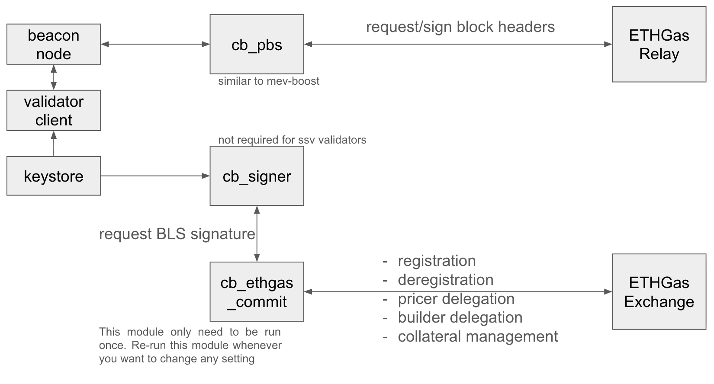

# ethgas-preconf-commit-boost-module

[](https://github.com/ethgas-developer/ethgas-preconf-commit-boost-module/actions/workflows/build-and-push.yml)
[](https://docs.ethgas.com/get-started/node-operators)
[](https://github.com/ethgas-developer/ethgas-preconf-commit-boost-module/releases)
[](https://x.com/ETHGASofficial)

## Overview

First and foremost, we would like to give a big shout out to the Commit-Boost team for making Ethereum a more open and cooperative environment! This repo allows you to run all Commit-Boost components related to ETHGas in Docker. There are 3 main components, i.e.

- `cb_pbs`: It serves a similar purpose as MEV-Boost.
- `cb_signer`: It securely generates signatures from the validator BLS private keys. If you use remote signer or want to onboard DVT validators, you don't need this component.
- `cb_ethgas_commit`: It requests signatures for ETHGas registration from `cb_signer` where the signatures are then sent to the ETHGas Exchange via REST API
  
- For more details on ETHGas architecture, please refer to [here](https://docs.ethgas.com/our-technology/the-ethgas-architecture).

## Build docker images

- For `cb_ethgas_commit` and `cb_gen_jwt`, you can either use our pre-built linux/amd64 or linux/arm64 docker image or run `./scripts/build.sh` to build it locally.
- For `cb_signer` and `cb_pbs`, you can either use the official image from Commit Boost team or use Dockerfile [here](https://github.com/Commit-Boost/commit-boost-client/tree/main/provisioning) to build it locally.

## Get started

- [Node operators - Quick Start Guide](https://docs.ethgas.com/get-started/node-operators/quick-start-guide)
- [Node operators - Detailed Example Config - Mainnet](./config.example.mainnet.toml)
- [Node operators - Detailed Example Config - Hoodi](./config.example.hoodi.toml)
- [Additional Configuration Notes](./extra-config-notes.md)

## Tests and coverage

The suite uses isolated local HTTP fixtures, temporary files, subprocess environments,
and an Anvil EVM. It never requires production credentials or a live network.
Install Anvil (Foundry v1.8.5; set `ANVIL_BIN` if it is not on `PATH`) and run:

```sh
cargo test --all-targets --locked
```

For the same coverage gate used by CI:

```sh
rustup component add llvm-tools-preview
cargo install cargo-llvm-cov --version 0.9.1 --locked
./scripts/test-coverage.sh
```

CI uses Rust 1.99.1 and requires at least **95% lines, regions, and functions**
across all production sources in `src/` and `bin/`. Only files under `tests/`
are excluded. Reports are written to `target/coverage.json` and
`target/coverage/html/index.html`. Coverage percentages do not measure assertion
quality or guarantee security; the suite also checks independent EIP-712/BLS
encodings, replay boundaries, credential redaction, failed registration side
effects, exact deposit value/calldata, receipts, and invalid configuration.
Physical Ledger interaction requires a separate hardware check.

The TLS regression suite checks the compromised eMudhra intermediate keys even
when their issuers are explicitly trusted, both bundled root stores, and a
legitimate certificate with hostname validation. Public certificates are stored
under `tests/data/emudhra`; their verification time is fixed so expiration cannot
hide a regression. To check an OpenSSL 3 system CA bundle separately, run:

```sh
sh scripts/check-ca-trust.sh tests/data/emudhra
```

JavaScript actions require the runner's embedded Node.js 24.22.1 or newer on the
24.x line. Both CI jobs start with an inline Bash check before checkout. It locates
the active Linux runner via `/proc`, checks its embedded Node.js version before
executing JavaScript, and verifies its bundled CA roots. Missing or outdated
runtimes fail the job; even coverage uploads require a successful check.
`setup-node` only changes Node.js for shell steps and does not satisfy this
requirement. All external actions are pinned to full commit SHAs with version
comments. When updating pins, verify upstream action metadata still uses `node24`
and has no `runs.pre` hook: GitHub runs those hooks before ordinary steps, which
would bypass this check. Keep the inline checks in both workflows identical.
Build environments require rustup 1.29.2 or newer. Existing deployments must pull
replacement images and recreate their containers; changing a tag alone does not
refresh running services.

CI also refreshes RustSec and gates known TLS/crypto vulnerabilities using
`scripts/check-tls-advisories.py`. The complete dependency report is uploaded as
`target/dependency-audit.json`; findings outside that gate are printed for
separate dependency maintenance and are not treated as a clean full audit.

## Audit

- The module has been audited by [Sigma Prime](https://sigmaprime.io). Find the report [here](https://github.com/ethgas-developer/ethgas-audit).

## Acknowledgements

- [Commit-Boost](https://github.com/Commit-Boost/commit-boost-client)

## If you need help...

- [ETHGas Doc](https://docs.ethgas.com)
- [ETHGas API Doc](https://developers.ethgas.com)
- [ETHGas X / Twitter](https://x.com/ETHGASofficial)
- [Commit-Boost Doc](https://commit-boost.github.io/commit-boost-client)

## License

MIT
